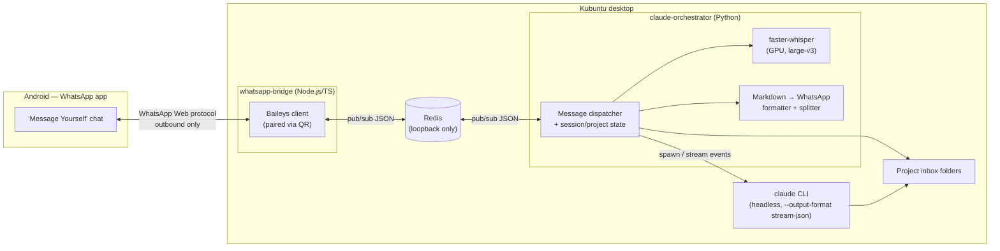

# Claude Code Remote Control via WhatsApp — Technical Specification

**Status:** Ready for implementation
**Author:** Produced via requirements interview (grilling session) with the project owner
**Date:** 2026-07-26

## 1. Purpose

Allow the project owner to send prompts to Claude Code — as text, voice notes, or file attachments — from a WhatsApp chat on their Android phone, and receive Claude Code's responses back as WhatsApp text messages. The system must run entirely on the owner's own Kubuntu desktop, using only a Claude Code Pro subscription (no Anthropic API billing), with no public IP address and no VPS.

## 2. Environment & Constraints

| Item | Value |
|---|---|
| OS | Ubuntu/Kubuntu 26.04 LTS ("resolute"), KDE Plasma (Wayland) |
| CPU | Intel Core i7-12650H, 10 cores |
| RAM | 30 GB |
| GPU | NVIDIA GeForce RTX 3060 Mobile, 6 GB VRAM, driver 595.84, CUDA 13.2 |
| Claude Code auth | Pro subscription only — CLI must run under the interactive OAuth login session, **not** an API key |
| Network | No public IP, no VPS, no port-forwarding, no inbound tunnel |
| Messaging | Owner's everyday personal WhatsApp number, via Android WhatsApp app |
| Language | No hard preference; Python selected for orchestration (matches existing project scaffold), Node.js/TypeScript required for the WhatsApp layer (see §4.1) |

**Hard operational requirement:** automatic suspend/sleep must be disabled on this machine. Screen lock / screensaver is fine (an active login session keeps running while locked), but if the machine sleeps, the WhatsApp connection drops and nothing can reach Claude Code until the machine is physically woken — there is no remote-wake path available under these constraints.

## 3. High-Level Architecture



Two independently-managed local processes (`whatsapp-bridge` and `claude-orchestrator`) communicate only through a local, loopback-only Redis instance. Neither process is reachable from outside the machine; the only outbound connection is the bridge's WebSocket to WhatsApp's own servers, which is why no public IP/VPS is required.

## 4. Components

### 4.1 `whatsapp-bridge` (Node.js / TypeScript)

- Uses **Baileys** (unofficial WhatsApp Web multi-device protocol library) to maintain a persistent connection to WhatsApp, paired once via QR code scan from the owner's phone.
- Baileys is Node/TypeScript-only, which is why this component exists in a different language from the rest of the system — its sole job is the WhatsApp wire protocol.
- Persists Baileys auth/session credentials to a local directory (e.g. `~/.local/share/whatsapp-bridge/auth/`) so re-pairing isn't needed after a restart.
- Filters all incoming events down to **only messages in the owner's own "Message Yourself" chat** (the thread where the account's own JID is both sender and recipient). Every other chat and group is ignored entirely at this layer — it is never even forwarded to Redis.
  - **LID caveat (confirmed live, 2026-07):** WhatsApp's newer identity system means a self-chat message can arrive addressed under either the account's phone-number JID (`...@s.whatsapp.net`) or its LID JID (`...@lid`), depending on which client sent it — a message typed on the phone itself was observed arriving as `@lid`, not `@s.whatsapp.net`. The bridge captures both identities at connection time (`socket.user.id` and `socket.user.lid`) and treats a match against *either* as the self-chat. A filter checking only one address silently drops every message with no error.
- Downloads and decrypts any media (voice notes, images, documents) attached to a qualifying message using Baileys' media-download API, writing it to a shared staging directory (e.g. `/var/tmp/whatsapp-bridge/incoming/<message-id>/`).
- Publishes a normalized JSON event to Redis channel `whatsapp:incoming` for every qualifying message (see §6.1 for schema).
- Subscribes to Redis channel `whatsapp:outgoing` and sends any message published there back into the self-chat, splitting into multiple WhatsApp messages if the text exceeds ~4000 characters.
- Applies a defense-in-depth check as a second safety net even though self-chat scoping should already guarantee only the owner can write there: it confirms Baileys' own `message.key.fromMe` flag is `true`, rather than string-matching a sender JID (WhatsApp sends `participant: ""` — not absent — on self-chat messages, and the LID/phone-number ambiguity above makes JID string-matching unreliable here). The outgoing event to the orchestrator is stamped with the configured `allowed_sender_jid` from config, not a JID parsed off the message, so the orchestrator's own allow-list check (§9) stays simple.

### 4.2 `claude-orchestrator` (Python)

- Subscribes to `whatsapp:incoming`, publishes to `whatsapp:outgoing`.
- Owns all business logic: command parsing, project/session state, transcription, Claude Code invocation, formatting, error handling, and cancellation.
- Maintains an in-memory (or lightweight local file/SQLite-backed) map of `project_name → { path, active_session_id, running_process }`.

### 4.3 Voice transcription

- `faster-whisper` running the `large-v3` model with the CUDA backend (CTranslate2), targeting the RTX 3060.
- Falls back to CPU (`medium` model) only if the GPU is unavailable at runtime (e.g. driver failure) — this is a resilience fallback, not the intended default path.
- Requires `ffmpeg` on the host for decoding WhatsApp's Opus/OGG voice notes before transcription.

### 4.4 Claude Code integration

- Invoked as the `claude` CLI in headless/print mode: `claude -p "<prompt>" --output-format stream-json --dangerously-skip-permissions` (flag names per the CLI version in use at implementation time; confirm exact flags against the installed Claude Code version).
- Runs with **working directory set to the active project's path**, and only that path — this is the sandboxing boundary since permissions are fully auto-approved.
- The CLI must be invoked under the same OS user/session that has completed the interactive `claude login` OAuth flow for the Pro subscription; no API key is configured or used anywhere in this system.
- Session continuity uses the CLI's own resume mechanism (`--continue` / `--resume <session-id>`) keyed per project, so conversation context persists across messages until explicitly reset.
- The orchestrator parses the `stream-json` event stream to (a) detect tool calls/results for progress reporting, and (b) capture the final response text.

### 4.5 Redis

- Runs locally (standard OS package, its own systemd-managed service), bound to `127.0.0.1` only, no exposed network interface, no authentication required given it is unreachable from outside the loopback interface.
- Used purely as a pub/sub message bus between the two components — not as a durable queue or database.

## 5. Message Flows

### 5.1 Plain text message

1. Owner sends a text message in the "Message Yourself" WhatsApp chat.
2. `whatsapp-bridge` publishes it to `whatsapp:incoming`.
3. `claude-orchestrator` checks whether it's a command (§7) or a prompt for the active project.
4. If a prompt: checks whether that project already has a task running.
   - If busy: publish an immediate "⏳ still working on your previous request" reply and stop (see §5.5).
   - If free: publish an immediate "⏳ Working on it..." acknowledgment, then invoke `claude` with `--continue`/`--resume` for that project's session.
5. While the process runs, the orchestrator batches `stream-json` events and publishes a progress-update message roughly every 10 seconds (see §5.4).
6. On completion, the orchestrator formats the final response (§5.6) and publishes it to `whatsapp:outgoing`.

### 5.2 Voice message

1. Owner sends a voice note in the self-chat.
2. `whatsapp-bridge` downloads/decrypts the audio to the staging directory and publishes an event referencing that file path (media, not text).
3. `claude-orchestrator` runs `faster-whisper` (GPU, `large-v3`) on the staged audio file to get a text transcript.
4. The transcript is treated exactly like a typed text message from that point on (step 3 onward in §5.1). The orchestrator should echo the transcript back to the owner as part of (or immediately before) the "Working on it..." acknowledgment, so the owner can catch transcription errors.

### 5.3 Attachment (file/image/document)

1. Owner sends a message with a file attached (with or without caption text) in the self-chat.
2. `whatsapp-bridge` downloads the file to the staging directory, publishes an event with the staged path and any caption text.
3. `claude-orchestrator` moves (not copies) the file into the active project's inbox folder — a fixed conventioned subfolder, e.g. `<project-path>/whatsapp-inbox/<timestamp>-<original-filename>`.
4. The orchestrator appends the saved relative path to the prompt text sent to Claude Code, e.g.: `User said: "<caption>" — attached file: whatsapp-inbox/2026-07-26T10-15-00-photo.png`.
5. Proceeds as a normal prompt (§5.1 step 4 onward).

### 5.4 Progress updates

- The orchestrator buffers all `stream-json` tool-call/tool-result events since the last flush.
- Every ~10 seconds while a task is still running, it sends one consolidated WhatsApp message summarizing what happened in that window (e.g. "🔧 Read 3 files, ran `pytest`, edited `app.py`").
- No update is sent if nothing new happened in that window, and no update is sent for tasks that finish faster than the first interval.

### 5.5 Busy / concurrency handling

- Only one active `claude` process per project at a time.
- A new prompt for a project that already has a running task gets an immediate reply (e.g. "⏳ Still working on your previous request for `<project>`. Send `/stop` to cancel it, or wait.") and is **not** queued — the owner must resend it after the task finishes or is stopped.
- Prompts for a *different* project than the one currently running are allowed to proceed independently (the "busy" restriction is per-project, not global).

### 5.6 Response formatting

- Claude Code's Markdown output is converted to WhatsApp-supported formatting on a best-effort basis: triple-backtick code blocks and inline code are preserved as WhatsApp monospace, `**bold**` → `*bold*`, headers are flattened to bold plain lines, tables are flattened to simple aligned text.
- Any response exceeding ~4000 characters is split across multiple sequential WhatsApp messages rather than truncated.

### 5.7 Error handling

- Any failure (non-zero exit, timeout, exception, denied action attempting to escape the sandboxed project directory) is caught by the orchestrator.
- The owner receives a short, human-readable summary (e.g. "❌ Claude Code failed after 2m — see log for detail: <short reason>").
- Full detail (stack trace, stderr, full stream-json event log) is written to a local log file, never sent verbatim over WhatsApp.

### 5.8 Cancellation

- Sending `/stop` while a task is running for the active project sends `SIGTERM` (escalating to `SIGKILL` after a grace period, e.g. 5s) to that project's active `claude` child process.
- The orchestrator confirms cancellation back to the owner (e.g. "🛑 Stopped.") and clears that project's "busy" state so a new prompt can be sent immediately.

## 6. Redis Channel Schemas

### 6.1 `whatsapp:incoming` (published by bridge, consumed by orchestrator)

```json
{
  "message_id": "string",
  "timestamp": "ISO-8601 string",
  "sender_jid": "string",
  "type": "text | voice | attachment",
  "text": "string | null",
  "media_path": "string | null",
  "media_mime_type": "string | null"
}
```

### 6.2 `whatsapp:outgoing` (published by orchestrator, consumed by bridge)

```json
{
  "text": "string",
  "in_reply_to": "message_id string | null"
}
```

## 7. Command Reference

All commands are plain text messages in the self-chat, starting with `/`.

| Command | Effect |
|---|---|
| `/project <name>` | Switch the active project for this conversation to `<name>` (must exist in configured project list). |
| `/projects` | List configured project names and their paths. |
| `/create <name>` | Create a new project folder under `project_root` and switch to it — see §7.2. |
| `/new` | Reset the active project's Claude Code session — the next prompt starts a fresh conversation instead of continuing. |
| `/stop` | Cancel the currently running task for the active project, if any. |
| `/enable` | Allow messages to reach Claude Code (global, all projects). |
| `/disable` | Stop messages from reaching Claude Code (global, all projects) — see §7.1. |
| `/status` | Report enabled/disabled state, active project, and whether it's busy or idle. |
| `/c <text>` | Send `<text>` to Claude Code verbatim as the prompt, bypassing the command table above — see §7.3. |
| `/help` | List available commands. |

Any message not starting with `/` is treated as a prompt (or, for voice/attachments, as described in §5.2/§5.3) for whichever project is currently active, **provided the enabled/disabled toggle (§7.1) is on**. There must always be a default active project on startup (first entry in the configured project list) so an owner who forgets to `/project` first still gets a sensible result.

### 7.1 Enabled/disabled toggle

The owner's everyday personal WhatsApp number is used for this integration, and the same "Message Yourself" self-chat also doubles as a personal notes/backup thread — so not every message typed there is meant for Claude Code. A global on/off toggle (not per-project — it gates the *channel*, not any particular project) controls this:

- While **enabled** (the default on first install), non-command messages behave exactly as described elsewhere in this document — text becomes a prompt, voice notes are transcribed then prompted, attachments are staged then prompted.
- While **disabled**, the orchestrator does nothing extra with non-command messages: no transcription, no attachment staging, no prompt to Claude Code, no reply at all. WhatsApp's own chat history is treated as sufficient "backup" — no separate archiving is implemented.
- Commands (`/project`, `/projects`, `/new`, `/stop`, `/enable`, `/disable`, `/status`, `/help`) always run regardless of the toggle state — otherwise there'd be no way to `/enable` again.
- `/disable` does not cancel a task already running (`/stop` still does that separately); it only gates *new* prompts from being dispatched.
- The toggle state persists across orchestrator restarts (a small local JSON state file, independent of `config.yaml`), so a deliberate `/disable` survives a crash/reboot/service update instead of silently reverting.

### 7.2 Dynamic project creation (`/create`)

Claude Code's working-directory confinement to a pre-configured project list (§9) is the only safety boundary once permissions are auto-approved, so letting a WhatsApp message target an arbitrary filesystem path was explicitly rejected (§7 Q4 of the original design interview). `/create` reopens *just enough* of that to be useful without reintroducing an open-ended path:

- **Bounded to one configured root.** `project_root` in `config.yaml` is the only parent directory `/create` may ever create folders under. If unset, `/create` is disabled entirely (replies with a config-not-set error).
- **Flat names only.** `<name>` must match `^[A-Za-z0-9_-]{1,100}$` — no slashes, no `..`, no nested paths. This makes path-traversal structurally impossible rather than relying on normalization logic to catch it.
- **One combined action.** `/create <name>` creates `<project_root>/<name>`, registers it, and switches the active project to it in one step.
- **Fails safe on collision, in both directions:**
  - `<name>` already a registered project → rejected, points to `/project <name>` instead.
  - A folder named `<name>` already exists under `project_root` but isn't registered → rejected outright, **not** silently adopted — an unregistered pre-existing folder could contain content the owner never intended to expose to a `--dangerously-skip-permissions` Claude Code session.
- **Persisted separately from `config.yaml`.** New projects are recorded in their own local JSON state file (same pattern as §7.1's toggle state) and merged with `config.yaml`'s static project list at orchestrator startup. `config.yaml` itself is never programmatically rewritten, so hand-written comments/formatting are never at risk. A dynamic project whose folder is later deleted out-of-band is silently skipped on the next startup (logged, not an error) rather than crashing the orchestrator.

### 7.3 Escaping to Claude Code's own commands/skills (`/c`)

Claude Code CLI has its own slash-command vocabulary (built-ins like `/usage`, plus plugin-provided skills like `/mattpocock-skills:grill-me`) that is entirely separate from this integration's command table above. Since §7 already claims every message starting with `/` for the orchestrator's own commands, anything typed as e.g. `/usage` would otherwise be swallowed and rejected as "Unknown command" before ever reaching Claude Code.

`/c <text>` is the escape hatch: `<text>` is forwarded verbatim as the Claude Code prompt, exactly as if it had been sent without a leading `/c ` (same busy-check, session-resume, and progress-update path as any other prompt — §5.4-§5.8). No special parsing of `<text>` is done on the orchestrator side; Claude Code CLI itself recognizes slash-command/skill syntax in the prompt it receives and dispatches accordingly (confirmed empirically: `claude -p "/mattpocock-skills:grill-me ..."` headless correctly invokes the `Skill` tool, the same as the interactive CLI). Some purely-interactive Claude Code built-ins (e.g. `/help`) reply "isn't available in this environment" headless regardless of how the prompt reaches them — that is a Claude Code CLI limitation, not something `/c` can work around.

`/c` is content bound for Claude, so — unlike the meta-commands in §7 — it is gated by the enabled/disabled toggle (§7.1) exactly like plain text: a `/c` sent while disabled is silently ignored, not rejected as an error.

## 8. Configuration

A local config file (e.g. `~/.config/claude-orchestrator/config.yaml`) defines:

```yaml
whatsapp:
  allowed_sender_jid: "<owner's WhatsApp JID>"

projects:
  - name: wasap-grill-me
    path: /home/centos/PycharmProjects/wasap_grill_me
  # additional projects as needed

# optional; parent directory /create may make new project folders under (§7.2)
project_root: /home/centos/PycharmProjects

claude_code:
  binary: claude
  # per-task hard timeout, e.g. 15m, after which the process is killed
  # and treated as a failure (§5.7)
  task_timeout_seconds: 900

whisper:
  model: large-v3
  device: cuda
  fallback_device: cpu
  fallback_model: medium

redis:
  host: 127.0.0.1
  port: 6379

progress_updates:
  interval_seconds: 10
```

## 9. Security Considerations

- **Blast radius containment:** Claude Code always runs with permissions auto-approved, so the *only* safety boundary is the working-directory confinement to configured project paths. The implementation must guarantee the `claude` process is never launched with a working directory outside the configured project list, and should not blindly trust paths embedded in message text for anything other than the attachment-inbox convention in §5.3. `/create` (§7.2) is the one deliberate, narrow exception to "the project list is static" — it can only ever add folders under one pre-configured `project_root`, with a flat, regex-validated name, so the boundary itself never moves.
- **Self-chat scoping is the primary access control.** Only the account owner can write to their own "Message Yourself" thread, which is why this is a stronger boundary than sender-ID filtering alone. `message.key.fromMe` (§4.1) is retained as defense-in-depth in case of a future Baileys/WhatsApp behavior change around that chat.
- **No inbound network exposure.** Redis is loopback-only; the bridge makes only outbound connections to WhatsApp's servers. There is no listening port reachable from outside the machine.
- **Local secrets:** Baileys' auth/session directory contains credentials equivalent to a logged-in WhatsApp Web session — treat it like a credential store (filesystem permissions restricted to the owning user, excluded from any backups that leave the machine unencrypted).
- **Known trade-off, accepted by the owner:** using the everyday personal WhatsApp number (rather than a dedicated one) means the bridge process technically observes all account traffic at the protocol level, even though it acts only on the self-chat. This was a deliberate choice weighed against the convenience of not needing a second number.

## 10. Deployment & Operations

1. **Prerequisites:** Node.js (current LTS), Python (≥3.11, matching existing `pyproject.toml` scaffold), `redis-server` (via apt), `ffmpeg`, CUDA + cuDNN matching the installed NVIDIA driver (595.84 / CUDA 13.2) for GPU-accelerated `faster-whisper`.
2. **Disable automatic suspend/sleep** in Kubuntu power settings (screen lock/screensaver may remain enabled).
3. **Pairing:** run the bridge interactively once to scan the WhatsApp QR pairing code; confirm the auth directory persists across restarts.
4. **systemd units** (both `systemctl --user`, so they start on login and stop on logout, per §9 in the interview):
   - `whatsapp-bridge.service` — runs the Node process.
   - `claude-orchestrator.service` — runs the Python process, `Requires=`/`After=` the bridge unit.
   - Both set `Restart=on-failure`.
   - `loginctl enable-linger <user>` should specifically **not** be used, since the design intentionally ties the service lifetime to an active login session rather than running unattended without any session.
5. **Logging:** each service logs to the systemd journal (`journalctl --user -u <unit>`) plus an application-level log file with rotation (e.g. Python `logging` with a `RotatingFileHandler`) for the detailed error traces referenced in §5.7.

## 11. Out of Scope (for this iteration)

- Official WhatsApp Business Cloud API integration.
- Group chat support.
- Multi-user support beyond the single owner allow-list.
- A dedicated/second WhatsApp number for the bot.
- Any inbound network exposure, tunneling, or remote-wake capability for the host machine.

## 12. Decision Log

| # | Decision | Choice |
|---|---|---|
| 1 | Messaging channel | Unofficial WhatsApp automation (Baileys) |
| 2 | Access control | Sender allow-list |
| 3 | Claude Code permissions | Auto-approved, confined to project folders |
| 4 | Project scope | Multiple projects, switchable via chat command |
| 5 | Session continuity | Persistent per project until `/new` |
| 6 | Voice transcription engine | Local, GPU-accelerated (`faster-whisper`) |
| 7 | Attachment handling | Fixed inbox folder inside active project |
| 8 | Long-task feedback | Immediate ack + streamed progress |
| 8b | Progress throttling | Time-based batching, ~10s |
| 9 | Process persistence | Login-scoped `systemd --user` service; auto-suspend disabled |
| 10 | Error handling | Sanitized WhatsApp summary + full local log |
| 11 | Response formatting | Markdown→WhatsApp conversion + auto-split |
| 12 | Language stack | Python orchestrator + Node/TS Baileys sidecar |
| 13 | Inter-process communication | Local Redis pub/sub |
| 14 | WhatsApp number | Owner's everyday personal number |
| 15 | Message scoping | "Message Yourself" self-chat only |
| 16 | Cancellation | `/stop` command (SIGTERM/SIGKILL) |
| 17 | Concurrency | Reject with notice; no queueing, no parallel runs |
| 18 | Whisper model | `large-v3`, GPU-accelerated |
| 19 | Claude routing control | Stateful `/enable`/`/disable`/`/status` toggle (not a per-message marker) |
| 20 | Disabled-message handling | Do nothing extra — WhatsApp's own history is the backup, no separate archiving |
| 21 | Toggle scope | Global (all projects), not per-project |
| 22 | Toggle persistence | Persisted to disk, survives restarts; fresh install defaults to enabled |
| 23 | Dynamic project scope | Bounded to one configured `project_root`, not an arbitrary path |
| 24 | `/create` UX | One combined command (create + switch), not two steps |
| 25 | Dynamic project persistence | Own state file, `config.yaml` never programmatically rewritten |
| 26 | Dynamic project naming | Flat names only, regex-validated — no nested paths |
| 27 | `/create` collision handling | Reject both directions (registered name, or unregistered existing folder) — never silently adopt |
| 28 | `/create` naming | `/create`, not `/newproject` — avoids clashing with `/new` and `/project` |
| 29 | Reaching Claude Code's own commands/skills | Dedicated escape command `/c <text>`, not a blanket fallthrough of unrecognized `/word` text — keeps the typo-safety of "Unknown command" errors for the orchestrator's own commands |
| 30 | `/c` toggle interaction | Gated by `/enable`/`/disable` like plain text, not always-on like the meta-commands — it delivers content to Claude, which is exactly what `/disable` suppresses |
