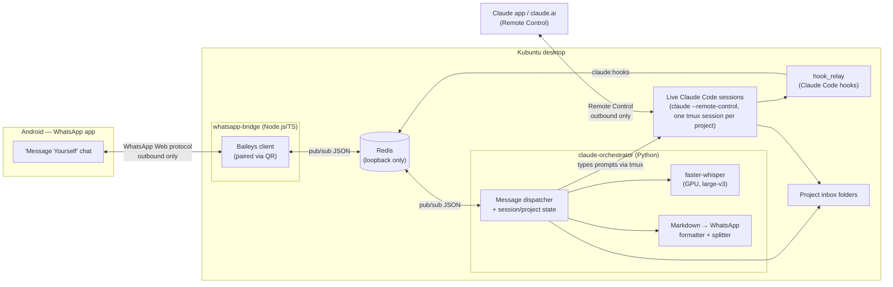

# Claude Code Remote Control via WhatsApp — Technical Specification

**Status:** Implemented and in daily use

## 1. Purpose

Allow the project owner to send prompts to Claude Code — as text, voice notes, or file attachments — from a WhatsApp chat on their Android phone, and receive Claude Code's responses back as WhatsApp text messages. The system must run entirely on the owner's own Kubuntu desktop, using only a Claude Code Pro subscription (no Anthropic API billing), with no public IP address and no VPS.

## 2. Environment & Constraints

| Item | Value |
|---|---|
| OS | Ubuntu/Kubuntu 26.04 LTS ("resolute"), KDE Plasma (Wayland) |
| CPU | Intel Core i7-12650H, 10 cores |
| RAM | 30 GB |
| GPU | NVIDIA GeForce RTX 3060 Mobile, 6 GB VRAM, driver 595.84, CUDA 13.2 |
| Claude Code auth | Pro subscription only — CLI must run under the interactive OAuth login session, **not** an API key |
| Network | No public IP, no VPS, no port-forwarding, no inbound tunnel |
| Messaging | Owner's everyday personal WhatsApp number, via Android WhatsApp app |
| Language | No hard preference; Python selected for orchestration (matches existing project scaffold), Node.js/TypeScript required for the WhatsApp layer (see §4.1) |

**Hard operational requirement:** automatic suspend/sleep must be disabled on this machine. Screen lock / screensaver is fine (an active login session keeps running while locked), but if the machine sleeps, the WhatsApp connection drops and nothing can reach Claude Code until the machine is physically woken — there is no remote-wake path available under these constraints.

## 3. High-Level Architecture



Two independently-managed local processes (`whatsapp-bridge` and `claude-orchestrator`) communicate only through a local, loopback-only Redis instance. Each project's Claude Code session is a third, long-lived process in its own tmux session (§4.4, §7.7), shared by WhatsApp, the Claude app and the computer. Nothing is reachable from outside the machine; the only outbound connections are the bridge's WebSocket to WhatsApp's servers and the sessions' Remote Control connection to Anthropic, which is why no public IP/VPS is required.

## 4. Components

### 4.1 `whatsapp-bridge` (Node.js / TypeScript)

- Uses **Baileys** (unofficial WhatsApp Web multi-device protocol library) to maintain a persistent connection to WhatsApp, paired once via QR code scan from the owner's phone.
- Baileys is Node/TypeScript-only, which is why this component exists in a different language from the rest of the system — its sole job is the WhatsApp wire protocol.
- Persists Baileys auth/session credentials to a local directory (e.g. `~/.local/share/whatsapp-bridge/auth/`) so re-pairing isn't needed after a restart.
- Filters all incoming events down to **only messages in the owner's own "Message Yourself" chat** (the thread where the account's own JID is both sender and recipient). Every other chat and group is ignored entirely at this layer — it is never even forwarded to Redis.
  - **LID caveat:** WhatsApp's newer identity system means a self-chat message can arrive addressed under either the account's phone-number JID (`...@s.whatsapp.net`) or its LID JID (`...@lid`), depending on which client sent it — the phone app addresses it via LID, WhatsApp Desktop/Web via the phone-number JID. The bridge captures both identities at connection time (`socket.user.id` and `socket.user.lid`) and treats a match against *either* as the self-chat. A filter checking only one address would silently drop every message from the other client with no error.
- Downloads and decrypts any media (voice notes, images, documents) attached to a qualifying message using Baileys' media-download API, writing it to a shared staging directory (e.g. `/var/tmp/whatsapp-bridge/incoming/<message-id>/`).
- Publishes a normalized JSON event to Redis channel `whatsapp:incoming` for every qualifying message (see §6.1 for schema).
- Subscribes to Redis channel `whatsapp:outgoing` and sends any message published there back into the self-chat, splitting into multiple WhatsApp messages if the text exceeds ~4000 characters.
- Applies a defense-in-depth check as a second safety net even though self-chat scoping should already guarantee only the owner can write there: it confirms Baileys' own `message.key.fromMe` flag is `true`, rather than string-matching a sender JID (WhatsApp sends `participant: ""` — not absent — on self-chat messages, and the LID/phone-number ambiguity above makes JID string-matching unreliable here). The outgoing event to the orchestrator is stamped with the configured `allowed_sender_jid` from config, not a JID parsed off the message, so the orchestrator's own allow-list check (§9) stays simple.
- When a message is a WhatsApp reply/quote (`contextInfo.quotedMessage` present — a protobuf field nested per content type, not on the message envelope), extracts quoted text verbatim, or re-downloads a quoted attachment/voice note on the spot using the same media-download API (§5.9/§7.6). No lookup against anything the bridge saw earlier is involved — everything needed (including, for media, the same reference data used to re-download normal attachments) is already embedded in `contextInfo.quotedMessage` itself.
- Negotiates the current WhatsApp Web protocol version via Baileys' `fetchLatestBaileysVersion()` at startup, rather than the version bundled with the pinned Baileys release — the bundled version can lag behind what WhatsApp's servers actually expect, which otherwise surfaces as a handshake-level rejection indistinguishable from a real outage.
- Reconnects after a dropped connection use exponential backoff — 5s, 10s, 20s, ... capped at 5 minutes — rather than a fixed delay, so a server actively rejecting reconnects isn't hammered at a constant rate. The delay resets to 5s only once a connection has stayed open for a full 60 seconds; a flap that closes again sooner doesn't count as recovery and keeps backing off from where it left off. After 10 failed attempts with no qualifying reset (~25 minutes total), the bridge logs an error and exits cleanly (exit code 0) rather than continuing to retry — `Restart=on-failure` in the systemd unit does not restart a clean exit, so the service is left stopped (`inactive (dead)`) until explicitly started again. A `loggedOut` disconnect is unaffected by any of this: it never reconnects at all and asks for re-pairing instead, same as before.

### 4.2 `claude-orchestrator` (Python)

- Subscribes to `whatsapp:incoming`, publishes to `whatsapp:outgoing`.
- Also subscribes to `claude:hooks` (§6.3), where the live sessions report their hook events.
- Owns all business logic: command parsing, project/session state, transcription, typing prompts into the live sessions, formatting, error handling, and cancellation.
- Keeps an in-memory map of `project_name → { path, queued WhatsApp prompts, in-flight WhatsApp turn }`, and persists each project's shared session ID and last answer in `state.json`.

### 4.3 Voice transcription

- `faster-whisper` running the `large-v3` model with the CUDA backend (CTranslate2), targeting the RTX 3060.
- Falls back to CPU (`medium` model) only if the GPU is unavailable at runtime (e.g. driver failure) — this is a resilience fallback, not the intended default path.
- Requires `ffmpeg` on the host for decoding WhatsApp's Opus/OGG voice notes before transcription.

### 4.4 Claude Code integration

- **One live session per project, shared by every channel.** Each project runs one interactive `claude --remote-control rc-<name>` process in its own detached tmux session (§7.7). WhatsApp, the Claude app (through Remote Control) and the computer (`tmux attach -t rc-<name>`) all drive that one process, so they share one conversation. A message sent from one channel is part of the context of the next message from any other.
- **WhatsApp prompts are typed into the session.** A single line is typed key by key (`tmux send-keys -l`), so a slash command goes through Claude Code's command menu as if typed by hand. Several lines go in as one bracketed paste (`tmux paste-buffer -p`), so their line breaks never submit early. Enter is pressed once after either.
- **Answers come back through hooks.** The session starts with an inline `--settings` that runs `hook_relay` (§6.3) on `SessionStart`, `UserPromptSubmit`, `PostToolUse` and `Stop`. The relay publishes each event to Redis, tagged with the tmux session name. `Stop` carries `last_assistant_message`, the text of Claude's final response. Each prompt has a `prompt_id` that its tool calls and its `Stop` repeat, which is how a WhatsApp turn's progress and answer are told apart from turns typed on the phone or the computer.
- **Telling WhatsApp's prompts apart.** Right before typing a message, the orchestrator writes a small marker file (`~/.local/share/claude-orchestrator/live/rc-<name>.pending.json`). The relay consumes it on the next `UserPromptSubmit` and tags that event `"origin": "whatsapp"`. A marker older than 30 seconds is ignored.
- **Session state.** Claude Code writes one `~/.claude/sessions/<pid>.json` per running process, with its session ID, `busy`/`idle` status, tmux target and, while Remote Control is connected, `bridgeSessionId`. The orchestrator reads it to know whether a session is busy, whether it is connected to the app, and which session ID it is on. The file is undocumented, so every field is read defensively.
- Runs with **working directory set to the project's path**, and only that path — this is the sandboxing boundary, since the session runs with `remote_control.permission_mode` (`bypassPermissions` by default).
- The CLI runs under the same OS user that has completed the interactive `claude login` OAuth flow for the Pro subscription; no API key is configured or used anywhere in this system.
- **Session continuity.** The session ID is remembered per project from `SessionStart`. When a session has to start again (after `/close`, a crash or a reboot), it resumes that ID with `--resume`. `/c /clear` starts a fresh conversation in the same process.
- Every session starts with a fixed `--append-system-prompt` telling Claude Code about the `whatsapp-outbox/` convention (§7.5), so the convention stays in context for the session's whole lifetime, whichever channel the prompts come from.

### 4.5 Redis

- Runs locally (standard OS package, its own systemd-managed service), bound to `127.0.0.1` only, no exposed network interface, no authentication required given it is unreachable from outside the loopback interface.
- Used purely as a pub/sub message bus between the two components — not as a durable queue or database.

### 4.6 Voice synthesis (TTS)

- `piper-tts` (ONNX-based, CPU by default — fast enough without a GPU, and avoids VRAM contention with §4.3's `large-v3` model on this machine's single GPU).
- Voice models download automatically on first use into `tts.models_dir`, mirroring `faster-whisper`'s own model-download behavior (§4.3) rather than requiring a separate manual setup step.
- `langdetect` picks which configured voice (English/Spanish) to use **per reply**, based on the language of that reply's own text — not the input message's language, and not a fixed config default (SPEC.md §7.4).
- Requires `ffmpeg` (already a prerequisite for §4.3) to convert Piper's WAV output to the Opus/OGG format WhatsApp voice notes require.
- Opt-in only, via `/voice on` (§7.4) — off by default, since synthesis is extra per-message work most sessions won't want.

## 5. Message Flows

### 5.1 Plain text message

1. Owner sends a text message in the "Message Yourself" WhatsApp chat.
2. `whatsapp-bridge` publishes it to `whatsapp:incoming`.
3. `claude-orchestrator` checks whether it's a command (§7) or a prompt for the active project.
4. If a prompt: makes sure the active project's live session is running, starting it (resuming its stored session) when it is not, with a "🟢 Session started" or "♻️ Session restarted" reply (§7.7).
5. Queues the prompt. If the session is busy, replies "⏳ Busy, queued" (see §5.5). Once the session is idle, publishes "⏳ Working on it..." and types the prompt into the session (§4.4).
6. While the turn runs, the orchestrator batches the turn's tool-call hook events and publishes a progress-update message roughly every 10 seconds (see §5.4).
7. When the turn's `Stop` event arrives, the orchestrator formats its `last_assistant_message` (§5.6) and publishes it to `whatsapp:outgoing`.
8. If voice replies are on (`/voice on`, §7.4), the orchestrator also synthesizes a voice note and publishes it as a second, separate `whatsapp:outgoing` message — a best-effort extra: a synthesis failure is logged but never blocks or retracts the text reply already sent in step 7. What gets synthesized is the short spoken-style summary Claude Code appends to its reply when voice is on (§7.4), falling back to the raw response text when no summary section is present.
9. After an answered turn, the orchestrator also scans the active project's `whatsapp-outbox/` folder and sends anything Claude Code placed there (§7.5, §5.9) — independent of whether voice replies are on.

### 5.2 Voice message

1. Owner sends a voice note in the self-chat.
2. `whatsapp-bridge` downloads/decrypts the audio to the staging directory and publishes an event referencing that file path (media, not text).
3. `claude-orchestrator` runs `faster-whisper` (GPU, `large-v3`) on the staged audio file to get a text transcript.
4. The transcript is treated exactly like a typed text message from that point on (step 3 onward in §5.1). The orchestrator should echo the transcript back to the owner as part of (or immediately before) the "Working on it..." acknowledgment, so the owner can catch transcription errors.

### 5.3 Attachment (file/image/document)

1. Owner sends a message with a file attached (with or without caption text) in the self-chat.
2. `whatsapp-bridge` downloads the file to the staging directory, publishes an event with the staged path and any caption text.
3. `claude-orchestrator` moves (not copies) the file into the active project's inbox folder — a fixed conventioned subfolder, e.g. `<project-path>/whatsapp-inbox/<timestamp>-<original-filename>`.
4. The orchestrator appends the saved relative path to the prompt text sent to Claude Code, e.g.: `User said: "<caption>" — attached file: whatsapp-inbox/2026-07-26T10-15-00-photo.png`.
5. Proceeds as a normal prompt (§5.1 step 4 onward).

### 5.4 Progress updates

- The orchestrator buffers the tool names of the WhatsApp turn's `PostToolUse` hook events (§4.4) since the last flush. Tool calls of turns typed on the phone or the computer are not reported.
- Every ~10 seconds while a task is still running, it sends one consolidated WhatsApp message summarizing what happened in that window (e.g. "🔧 Read 3 files, ran `pytest`, edited `app.py`").
- No update is sent if nothing new happened in that window, and no update is sent for tasks that finish faster than the first interval.

### 5.5 Busy / concurrency handling

- One live session per project, and one turn at a time in it, whichever channel started the turn.
- A WhatsApp prompt that arrives while the session is busy (with a WhatsApp turn, earlier queued prompts, or a turn typed on the phone or the computer) is queued, with an immediate "⏳ Busy, queued. Send /stop to drop it." reply. Queued prompts are typed in one at a time, in order, each once the session reports idle.
- The session reports busy for a moment after it answers, so a session is only called busy once it stays busy for 2 seconds.
- Prompts for a *different* project run independently (the queue is per project, not global).

### 5.6 Response formatting

- Claude Code's Markdown output is converted to WhatsApp-supported formatting on a best-effort basis: triple-backtick code blocks and inline code are preserved as WhatsApp monospace, `**bold**` → `*bold*`, headers are flattened to bold plain lines, tables are flattened to simple aligned text.
- Any response exceeding ~4000 characters is split across multiple sequential WhatsApp messages rather than truncated.

### 5.7 Error handling

- Any failure (a session that fails to start or exits mid-turn, a turn with no answer after `claude_code.task_timeout_seconds`, a typed message the session never confirms, an exception) is caught by the orchestrator. A timed-out turn is interrupted with Esc.
- The owner receives a short, human-readable summary (e.g. "❌ Claude Code failed after 2m — see log for detail: <short reason>").
- Full detail (stack traces, the session's own output) is written to a local log file or stays in the tmux pane, never sent verbatim over WhatsApp.

### 5.8 Cancellation

- `/stop` drops every WhatsApp prompt still queued for the active project ("🛑 Dropped N queued messages"), and, if the session is running a turn, presses Esc in it — the same interrupt as at the keyboard, whichever channel started the turn.
- An interrupted turn ends with no `Stop` event, so a WhatsApp turn also ends when the session reports idle for 3 polls in a row; the orchestrator then replies "🛑 Stopped." and the next queued prompt can go in.

### 5.9 Outgoing files from Claude Code (`whatsapp-outbox/`)

The reverse of §5.3 — Claude Code, not the owner, decides a file should leave the project (§7.5).

1. At some point during the task, Claude Code (told about the convention via the system prompt, §4.4) uses its own Write/Bash tools to save a file into `<project-path>/whatsapp-outbox/`.
2. Once the prompt completes successfully (§5.1 step 6-8), the orchestrator scans that folder's top level (not `sent/`).
3. Each file ≤ 64MB is moved into `whatsapp-outbox/sent/<filename>` and published to `whatsapp:outgoing` as its own message (mimetype guessed from the extension, caption set to the filename, `delete_after_send: false` since the orchestrator already relocated it to its permanent home).
4. Each file over 64MB is left in place (not moved, not sent) and reported back with a short error reply instead.

### 5.10 Replying to (quoting) an earlier message

Applies uniformly on top of §5.1-§5.3 and §7.3's `/c` — a reply can itself be text, voice, or an attachment, and can quote a message in either direction (something the owner sent, or something the orchestrator/Claude Code sent).

1. The bridge checks whether the incoming message carries `contextInfo.quotedMessage` (§4.1). If not, nothing changes from §5.1-§5.3.
2. If the quoted message was text, its text is included verbatim — no download, no lookup.
3. If the quoted message was an attachment or voice note, the bridge re-downloads it on the spot (a one-shot fetch, not a persisted mapping — §7.6 Q1) and stages it into `whatsapp-inbox/` exactly like a fresh attachment (§5.3), hash-suffixed the same way (§7.6).
4. If that download fails (e.g. the quoted media has since expired on WhatsApp's servers), the orchestrator falls back to a generic note naming what type of thing was quoted, without a file reference.
5. Either way, the resulting context is prepended to whatever the owner actually typed/said/attached, e.g. `Replying to attached file: whatsapp-inbox/2026-...-photo_a1b2c3d4.jpg\n\n<the new message>`, before proceeding as a normal prompt (§5.1 step 4 onward).

## 6. Redis Channel Schemas

### 6.1 `whatsapp:incoming` (published by bridge, consumed by orchestrator)

```json
{
  "message_id": "string",
  "timestamp": "ISO-8601 string",
  "sender_jid": "string",
  "type": "text | voice | attachment",
  "text": "string | null",
  "media_path": "string | null",
  "media_mime_type": "string | null",
  "quoted_text": "string | null",
  "quoted_media_path": "string | null",
  "quoted_media_mime_type": "string | null",
  "quoted_media_type_label": "string | null"
}
```

The four `quoted_*` fields are populated regardless of `type` (§5.10) — a reply can itself be text, voice, or an attachment. `quoted_text` is set verbatim for quoted text; `quoted_media_path`/`quoted_media_mime_type` are set when a quoted attachment/voice note was successfully re-downloaded; `quoted_media_type_label` (e.g. `"image"`, `"voice message"`) is set whenever the quoted message was media, whether or not the download itself succeeded — it's the fallback description when `quoted_media_path` is absent.

### 6.2 `whatsapp:outgoing` (published by orchestrator, consumed by bridge)

```json
{
  "text": "string | null",
  "in_reply_to": "message_id string | null",
  "media_path": "string | null",
  "media_mime_type": "string | null",
  "media_filename": "string | null",
  "caption": "string | null",
  "delete_after_send": "boolean"
}
```

Exactly one of `text`/`media_path` is set per message (§7.4/§7.5) — a voice-note or file reply is its own separate message on this channel, not a caption alongside the text reply for the same result. `caption`/`media_filename` are only meaningful alongside `media_path`. When `media_mime_type` starts with `audio/`, the bridge sends it as a WhatsApp `ptt` voice note (§7.4); otherwise as a document, using `media_filename`/`caption` (§7.5). `delete_after_send` tells the bridge whether to delete `media_path` once sent: `true` for TTS's own temp files (§4.6), `false` for `whatsapp-outbox/` files, which the orchestrator has already relocated to their permanent `sent/` home. Either way, this is the one case where the orchestrator hands the bridge a filesystem path to read directly — the reverse of §6.1's incoming media flow (whether that path lives under `bridge.outgoing_staging_dir` for TTS, or inside a project's own `whatsapp-outbox/sent/` for files, doesn't matter to the bridge; both processes run as the same OS user on the same machine).

### 6.3 `claude:hooks` (published by `hook_relay`, consumed by orchestrator)

```json
{
  "hook_event_name": "SessionStart | UserPromptSubmit | PostToolUse | Stop",
  "live_session": "rc-<name>",
  "session_id": "string",
  "prompt_id": "string",
  "source": "startup | resume | clear | compact",
  "tool_name": "string",
  "last_assistant_message": "string",
  "origin": "whatsapp"
}
```

Only the fields present in the hook event are forwarded; tool inputs and outputs never are. `origin` is set only on a `UserPromptSubmit` that consumed a pending WhatsApp marker (§4.4). The relay never fails the hook: errors go to stderr and it exits 0.

## 7. Command Reference

All commands are plain text messages in the self-chat, starting with `/`.

| Command | Effect |
|---|---|
| `/project <name-or-number>` | Switch the active project — any `config.yaml` project, or any project folder under `project_root` or one of its `project_containers` — by name or by its `/projects` list number — and start that project's live session (§7.7). A second message previews Claude's last answer in that project. Naming a container lists its projects instead. See §7.2. |
| `/projects` | List every available project (config.yaml plus every `project_root` project folder), numbered, with each container's projects grouped under it. |
| `/create <name>` | Create a new project folder under `project_root` (`<name>`) or under one of its containers (`<container>/<name>`) switch to it and start its live session — see §7.2, §7.7. |
| `/close [name-or-number]` | Stop a project's live session — the active project's when no argument is given. See §7.7. |
| `/last` | Send Claude's full last answer in the active project, whichever channel the prompt came from. |
| `/stop` | Drop the active project's queued WhatsApp prompts and interrupt its running turn — see §5.8. |
| `/reconnect [name-or-number]` | Connect a project's live session to the Claude app again, e.g. after it was archived there — see §7.7. |
| `/enable` | Allow messages to reach Claude Code (global, all projects). |
| `/disable` | Stop messages from reaching Claude Code (global, all projects) — see §7.1. |
| `/status` | Report enabled/disabled state, voice replies, active project and whether it's busy, idle or has queued prompts, its session ID (or "none yet"), the `tmux attach` command for the computer, and every Remote Control session — see §7.7. |
| `/c <text>` | Type `<text>` into the session as is, bypassing the command table above, e.g. `/c /usage` or `/c /clear` — see §7.3. |
| `/voice on` \| `/voice off` | Also send replies as a voice note, in the reply's own detected language (off by default) — see §7.4. |
| `/help` | List available commands, grouped into Projects, Session, Settings and Pass-through. |

Any message not starting with `/` is treated as a prompt (or, for voice/attachments, as described in §5.2/§5.3) for whichever project is currently active, **provided the enabled/disabled toggle (§7.1) is on**. There must always be a default active project on startup (first entry in the configured project list) so an owner who forgets to `/project` first still gets a sensible result.

### 7.1 Enabled/disabled toggle

The owner's everyday personal WhatsApp number is used for this integration, and the same "Message Yourself" self-chat also doubles as a personal notes/backup thread — so not every message typed there is meant for Claude Code. A global on/off toggle (not per-project — it gates the *channel*, not any particular project) controls this:

- While **enabled** (the default on first install), non-command messages behave exactly as described elsewhere in this document — text becomes a prompt, voice notes are transcribed then prompted, attachments are staged then prompted.
- While **disabled**, the orchestrator does nothing extra with non-command messages: no transcription, no attachment staging, no prompt to Claude Code, no reply at all. WhatsApp's own chat history is treated as sufficient "backup" — no separate archiving is implemented. This silence is specifically for non-command text/voice/attachments, since those could plausibly be personal notes.
- Commands (`/project`, `/projects`, `/create`, `/close`, `/last`, `/stop`, `/reconnect`, `/enable`, `/disable`, `/voice`, `/status`, `/help`) always run regardless of the toggle state — otherwise there'd be no way to `/enable` again.
- Anything else starting with `/` — `/c` (§7.3) or an unrecognized command like `/usage` — is unambiguously an attempted command, never a personal note, so while disabled it gets an explicit "🔴 Claude Code is disabled. Send /enable first." reply instead of either running or going silent. This also means an unrecognized command's reply differs depending on toggle state: the disabled notice takes priority over "Unknown command" while disabled, since that's the more actionable fact.
- `/disable` does not cancel a turn already running or prompts already queued (`/stop` does that separately); it only gates *new* prompts from being dispatched.
- The toggle state persists across orchestrator restarts (a small local JSON state file, independent of `config.yaml`), so a deliberate `/disable` survives a crash/reboot/service update instead of silently reverting.

### 7.2 Project discovery (`project_root`) and dynamic creation (`/create`)

Claude Code's working-directory confinement to a pre-configured project list (§9) is the only safety boundary once permissions are auto-approved, so letting a WhatsApp message target an arbitrary filesystem path is never allowed. `project_root` is the one deliberate, bounded exception — the entire subtree the owner already trusts enough to let Claude Code run against, so *nothing under it* needs a separate registration step to become switchable:

- **Every immediate, non-hidden subfolder of `project_root` is automatically an available project, unless it is a container** — discovered live (re-scanned on every `/project`/`/projects` call, not cached), merged with `config.yaml`'s static project list and deduplicated both by name (a static entry always wins a name collision) *and* by resolved path (a static entry named e.g. `wasap-grill-me` pointing at a folder literally called `wasap_grill_me` must not also appear a second time under that basename — same directory, two names, would otherwise become two independent sessions racing against one `cwd`). If `project_root` is unset, only the static list is available.
- **Containers (`project_containers`) hold projects instead of being one.** `config.yaml` lists them as paths relative to `project_root` (e.g. `c`, `c/car`). A container is scanned one level deep with the same rule as `project_root`: each non-hidden subfolder is a project, unless it is itself a listed container. Nested projects are named by their path relative to `project_root` (`c/whey`, `c/car/maintenance`), so a nested folder never collides with a top-level one of the same basename. A container is only reached through `project_root` or another listed container, so depth is set by what is listed, not by a separate limit. A listed container whose folder is missing is skipped, with a warning in the service log at startup. The container list is read once, at startup. A container itself is never selectable: `/project <container>` replies with that container's projects instead of switching.
- **No registration step, no persisted project list.** Switching to a project_root folder for the first time or `/create`-ing one simply adds it to the orchestrator's in-memory project registry for the rest of that process's lifetime; nothing is written to disk beyond the folder itself. `project_root` is the single source of truth, so there's nothing else that needs to stay in sync with it.
- **`/project <name-or-number>`** accepts either a project name or its number from the current `/projects` listing. Numbers reflect a fresh scan each time, sorted alphabetically by path part (so a container's projects come right after the container) for a predictable (if not permanently stable) order — list, then act on it promptly.
- **`/projects` groups nested projects under their container.** Each container is an unnumbered `📁 <container>` header, and its projects (and sub-containers) follow it, indented two spaces per level. The reply to `/project <container>` shows the same subtree with the same numbers.
- **`/projects` shows just the name for anything under `project_root`** — the path is redundant once every such project already shares that root. A static `config.yaml` entry whose path falls *outside* `project_root` still shows its full path, since there's no shared root to omit it against.
- **`/create <name>`** still exists for the one thing discovery alone can't do: making a *new* empty folder, directly under `project_root` (`<name>`) or inside a listed container that exists (`<container>/<name>`, e.g. `c/car/newapp`). The new folder's own name must match `^[A-Za-z0-9_-]{1,100}$` — no slashes, no `..` — and its parent must be `project_root` or a known container, making path-traversal structurally impossible rather than relying on normalization logic to catch it. It's otherwise just `mkdir` + switch — no separate registration, since the folder is automatically a project the instant it exists. Fails safe on collision (name already available, from either source) rather than silently adopting or overwriting.

### 7.3 Escaping to Claude Code's own commands/skills (`/c`)

Claude Code CLI has its own slash-command vocabulary (built-ins like `/usage`, plus plugin-provided skills like `/mattpocock-skills:grill-me`) that is entirely separate from this integration's command table above. Since §7 already claims every message starting with `/` for the orchestrator's own commands, anything typed as e.g. `/usage` would otherwise be swallowed and rejected as "Unknown command" before ever reaching Claude Code.

`/c <text>` is the escape hatch: `<text>` is typed into the active project's live session as is (§4.4), through the same queue as any other prompt (§5.5). Claude Code itself recognizes slash-command and skill syntax, the same as when typed at the keyboard, so short skill names (`/grill-me`) work too. What comes back depends on what `<text>` turns out to be:

- **A prompt or a skill** fires `UserPromptSubmit` and is answered like any prompt (§5.1).
- **`/clear`** starts a fresh conversation in the same process; Remote Control stays connected with the same app link. The orchestrator waits for the `SessionStart` event with `source: "clear"`, stores the new session ID, and replies "🧹 Session cleared".
- **Any other built-in command** (`/usage`, `/cost`, `/model`...) never becomes a prompt, so Claude writes no answer. When no `UserPromptSubmit` arrives within 3 seconds, the orchestrator waits 2 more seconds, captures the tmux screen and replies with the useful part in a monospace block: below the top border of a full-screen panel, or what follows the command's echo, up to the input box. It then presses Esc to close any panel the command left open.

A slash command goes in alone, so the session still sees it as a command; any other `/c` text gets the quoted-message context (§5.10) like a normal prompt.

`/c` is content bound for Claude, so — unlike the meta-commands in §7 — it is gated by the enabled/disabled toggle (§7.1): a `/c` sent while disabled replies with an explicit "Claude Code is disabled" notice rather than running (§7.1).

### 7.4 Voice replies (`/voice on` / `/voice off`)

Text and voice/attachment inputs already convert *to* text (§5.1-§5.3); this is the reverse direction — an optional voice note sent back *alongside* the text reply Claude Code already always produces.

- **Global toggle, off by default.** `/voice on` / `/voice off` is a second, independent toggle from §7.1's `claude_enabled` — same persisted-state-file pattern (`state.json`), same "always runs regardless of `claude_enabled`" treatment as the other meta-commands in §7, but defaults to off rather than on, since synthesis is extra per-message cost most sessions won't want.
- **Voice in addition to text, never instead of it.** Every reply while voice is on is delivered as both the existing text message(s) (§5.6) and one separate voice-note message (§6.2) — never a replacement, and progress updates (§5.4) stay text-only either way.
- **A short spoken summary, not a full readout.** While voice is on, each WhatsApp prompt carries an instruction (added by `hook_relay` as `UserPromptSubmit` context, §4.4, so prompts from the phone or the computer never get it) telling Claude Code to end its reply with a `## 🔊 Audio Summary` heading followed by a spoken-style summary (~100 words or fewer) of the answer; the voice note speaks that summary rather than reading the full text reply aloud. The text reply itself is unaffected and always carries the complete answer. If Claude Code's reply has no summary section, the voice note speaks the full reply text instead.
- **Language is detected per reply, not configured or matched to the input.** Right before synthesis, `langdetect` classifies whichever text is actually being spoken (the summary when present, the full reply text otherwise) and picks the matching voice from `tts.voices` (English/Spanish, §4.6, §8) — asking in Spanish and getting an English-language reply back produces an English voice note, and vice versa. Any detected language with no configured voice falls back to `en`.
- **Markdown is stripped for speech only.** The text channel keeps full Markdown formatting (§5.6) unchanged; only the copy fed to Piper has formatting markers removed and fenced/inline code replaced with a short spoken placeholder ("(code block omitted)") — code read aloud character-by-character isn't meaningful.
- **Best-effort, never blocks the text reply.** A synthesis failure (model load error, `ffmpeg` failure, etc.) is logged and silently skipped — the text reply already sent is never held back or retracted waiting on voice.

### 7.5 Outgoing files from Claude Code (`whatsapp-outbox/`)

The reverse of §5.3's incoming-attachment convention — Claude Code itself, not the owner, decides a file should be delivered back (e.g. a generated PDF report), by placing it in a fixed folder inside the project it's already confined to.

- **Convention, not a tool.** Claude Code has no dedicated "send to WhatsApp" tool — it only has Read/Write/Bash inside the active project directory. It's made aware of the `whatsapp-outbox/` convention via a fixed `--append-system-prompt` string given when its live session starts (§4.4), not a per-project `CLAUDE.md` edit, so it works out of the box in any configured project.
- **Only that one folder is ever touched.** The orchestrator scans exactly `<project>/whatsapp-outbox/`'s top level after each answered WhatsApp turn (§5.9) — nothing else Claude Code creates anywhere else in the project is ever sent.
- **Archived, not deleted, after sending.** Each sent file is moved into `whatsapp-outbox/sent/` as it's picked up — this is also what makes "already sent" durable across restarts with no separate state file: a file is pending if and only if it's still sitting in the top-level folder.
- **64MB cap, oversized files rejected with a clear reply.** A file over the cap is left in place (not moved to `sent/`, not sent) and reported back with a short error — it'll be picked up again after the next answered WhatsApp turn once it's small enough or removed.
- **Any file type**, not restricted to PDF — mimetype is guessed from the file extension; unrecognized extensions fall back to `application/octet-stream`.
- **Self-ignoring.** The first time a project's `whatsapp-outbox/` is used, a `.gitignore` containing just `*` is created inside it, so the folder and everything in it stay out of git without touching the project's own `.gitignore`. That `.gitignore` is never sent or moved to `sent/`.
- **Filenames are content-hash-suffixed** (e.g. `report_a3f9c2d1.pdf`) — see §7.6, which applies the same naming rule to `whatsapp-inbox/` too.

### 7.6 Replying to (quoting) an earlier message

WhatsApp's native reply/quote feature, distinct from forwarding — see §5.10 for the step-by-step flow. Two things worth calling out about the design, not just the mechanics:

- **No persistent tracking system.** A quoted attachment/voice note is simply re-downloaded fresh at reply-time (§5.10 step 3), the same one-shot media-download call already used for a normal attachment — not resolved through a WhatsApp-message-id → project-file-path index. No state file to maintain, no bridge→orchestrator acknowledgment channel, nothing that can fall out of sync across a restart.
- **Content-hash filenames, both directions.** Because Claude Code could plausibly generate the same filename (e.g. `report.pdf`) more than once across different tasks, and because replies mean the same underlying file can end up referenced from more than one place over time, both `whatsapp-inbox/` (§5.3) and `whatsapp-outbox/sent/` (§7.5) suffix the stored filename with the first 8 hex characters of the file's own sha256 (e.g. `report_a3f9c2d1.pdf`) — identical content always produces the identical suffix, and two different files never silently overwrite one another.

### 7.7 Shared live sessions (`/project`, `/create`, `/close`, `/reconnect`, `/status`)

Each project has one live, interactive Claude Code session with Remote Control on, shared by WhatsApp, the Claude app and the computer (§4.4). It shows up in the Claude app as a full Claude Code session — skills, hooks, MCP servers and `CLAUDE.md` included.

- **One session per project, in its own detached tmux session.** The tmux session name is `rc-` plus the project name with every character outside `[A-Za-z0-9_-]` replaced by `-` (`c/whey` → `rc-c-whey`); the same name is given to `--remote-control`, so it is what the app shows. Names, not `/projects` numbers, are used because the numbers shift as folders come and go (§7.2). From the computer, `tmux attach -t rc-c-whey` opens the same session; the launch reply and `/status` show that command.
- **Started by `/project`, `/create`, or the first WhatsApp prompt.** If the project's tmux session is already live, `/project` reports "already live" and starts nothing. A session whose process has exited is removed and started again. A WhatsApp prompt for a project with no running session starts it first (§5.1).
- **Command line:** `<claude_code.binary> --remote-control rc-<name> --permission-mode <remote_control.permission_mode> --chrome|--no-chrome --settings <hook JSON> --append-system-prompt <outbox convention> [--resume <session ID>]` (§8). The permission mode defaults to `bypassPermissions`, so the session never asks for approval, whichever channel drives it (decision #3). `auto` still stops to ask about actions its safety check flags. `--chrome` or `--no-chrome` comes from `remote_control.chrome`, off by default: browser work goes through the Playwright MCP plugin, not the owner's real, logged-in Chrome. `--resume` is given when the project has a stored session ID (§4.4).
- **The owner's own environment.** The session runs through the owner's login shell in interactive mode (`<shell> -lic`), so it gets the same environment as a terminal (`PATH`, Node version managers, `~/.bashrc`), not the orchestrator service's. The service's `LD_LIBRARY_PATH` (§10) is removed. The arguments reach the binary as `"$0" "$@"`, never parsed by the shell. Claude Code itself reads the owner's `~/.claude` settings, plugins, hooks and MCP servers, as for any session run by that user; the hook settings passed on the command line are added to those.
- **Folder trust.** The session has no one to answer Claude Code's folder-trust prompt, so before starting it the orchestrator sets `projects["<absolute path>"].hasTrustDialogAccepted = true` in `~/.claude.json` — the same flag the prompt writes. The file is written only when the flag is missing or false, through a temp file and rename. Only folders the dispatcher resolved from the project list (§7.2) are ever marked, never a path from message text.
- **Outside the service's lifetime.** The tmux server is started through `systemd-run --user --scope`, so it lives in its own scope unit and a restart of `claude-orchestrator.service` leaves every session running. Sessions do not come back after a reboot or logout until `/project` or the next WhatsApp prompt, and do not stop on their own when idle; `/close` stops one.
- **Reply.** The orchestrator waits up to 30 seconds for the session to register with Remote Control (`bridgeSessionId` in its `~/.claude/sessions/<pid>.json`, §4.4), then replies "📱 rc-<name> is live in the Claude app" with the `https://claude.ai/code/<id>` link, followed by "🖥️ On the computer:" with the `tmux attach -t rc-<name>` command and "🚪 To leave, close the terminal window or tab; /exit ends the session". Closing the terminal only detaches its tmux client, so the session keeps running; `/exit` ends the Claude Code process, and with it the session. A session that exits first is reported with the last 15 lines of its output and removed. A session still not connected after the wait is left running and reported as not connected yet, with the same `tmux attach` command. The project switch stands whatever the outcome.
- **Archived in the app.** Archiving the session in the Claude app disconnects Remote Control; the local process keeps running, so WhatsApp and the computer keep working. `/status` shows it as not connected, and `/reconnect` types `/remote-control` into it, which connects it again and replies with the new link.
- **Switching away does not close.** `/project` to another project leaves the earlier session running, still reachable from the app and the computer.
- **`/status` lists every Remote Control session**, one `◦` line each, under its own "📱 *Remote Control*" heading so they read apart from the bullets above them:
  - 🟢 connected to the app, with busy or idle;
  - 🟡 running, but not connected to the app (or still starting), with the `/reconnect <name>` to use;
  - 🔴 exited without `/close`, with the last line it printed — reported once, then its kept tmux pane is removed;
  - ⚪ a Claude Code process with Remote Control on in a project folder that this orchestrator did not start (e.g. started by hand in a terminal), labelled "started outside WhatsApp". `/close` never stops these.

## 8. Configuration

A local config file (e.g. `~/.config/claude-orchestrator/config.yaml`) defines:

```yaml
whatsapp:
  allowed_sender_jid: "<owner's WhatsApp JID>"

projects:
  - name: wasap-grill-me
    path: /home/centos/PycharmProjects/wasap_grill_me
  # additional projects as needed

# optional; parent directory /create may make new project folders under (§7.2)
project_root: /home/centos/PycharmProjects
# optional; folders under project_root that hold projects (§7.2)
project_containers:
  - c
  - c/car

claude_code:
  binary: claude
  # hard timeout per WhatsApp turn, e.g. 15m, after which the turn is
  # interrupted and treated as a failure (§5.7)
  task_timeout_seconds: 900

# each project's shared live session (§7.7)
remote_control:
  # acceptEdits | auto | bypassPermissions | default | dontAsk | plan
  permission_mode: bypassPermissions
  # Claude in Chrome for the session; off means Playwright MCP only
  chrome: false

whisper:
  model: large-v3
  device: cuda
  fallback_device: cpu
  fallback_model: medium

# voice replies via /voice on (§7.4), off by default
tts:
  voices:
    en: en_US-ljspeech-high
    es: es_AR-daniela-high
  device: cpu  # intentional: avoids VRAM contention with whisper.device: cuda above
  models_dir: ~/.local/share/claude-orchestrator/piper-voices

redis:
  host: 127.0.0.1
  port: 6379
  hooks_channel: "claude:hooks"  # hook events from the live sessions (§6.3)

progress_updates:
  interval_seconds: 10

bridge:
  # shared: orchestrator writes synthesized voice-reply audio here, bridge
  # reads/sends/deletes it (§6.2, §7.4) — the rest of this section is
  # Node-bridge-only (auth_dir, staging_dir)
  outgoing_staging_dir: /tmp/whatsapp-bridge/outgoing
```

## 9. Security Considerations

- **Blast radius containment:** Claude Code always runs with permissions auto-approved, so the *only* safety boundary is the working-directory confinement to configured project paths. The implementation must guarantee the `claude` process is never launched with a working directory outside the configured project list, and should not blindly trust paths embedded in message text for anything other than the attachment-inbox convention in §5.3. `project_root` (§7.2) is the one deliberate, bounded exception to "the project list is static" — both `/create` and switching to an already-existing folder are confined to that one pre-configured directory (regex-validated folder names, inside `project_root` or a listed container, for `/create`), so the boundary itself never moves; it just means the owner is trusting the *entire* `project_root` subtree up front, not each folder individually as it's first used.
- **Shared live sessions (§7.7) widen who drives a project, not where.** Each session runs in a project folder from the same project list, so the working-directory boundary above holds. What changes is the client: anyone signed in to the owner's Claude account can drive a live session from the Claude app or claude.ai. Setting `hasTrustDialogAccepted` skips the folder-trust prompt only for folders already inside that boundary; it is never set for a path taken from message text. The session's permission mode (`remote_control.permission_mode`, §8) decides what it may do without asking, whichever channel drives it.
- **The hook relay only reports.** `hook_relay` runs as the owner, publishes to the loopback-only Redis, and its only effect on the session is the voice-summary instruction it adds to WhatsApp prompts (§7.4).
- **Self-chat scoping is the primary access control.** Only the account owner can write to their own "Message Yourself" thread, which is why this is a stronger boundary than sender-ID filtering alone. `message.key.fromMe` (§4.1) is retained as defense-in-depth in case of a future Baileys/WhatsApp behavior change around that chat.
- **No inbound network exposure.** Redis is loopback-only; the bridge makes only outbound connections to WhatsApp's servers. There is no listening port reachable from outside the machine.
- **Local secrets:** Baileys' auth/session directory contains credentials equivalent to a logged-in WhatsApp Web session — treat it like a credential store (filesystem permissions restricted to the owning user, excluded from any backups that leave the machine unencrypted).
- **Known trade-off, accepted by the owner:** using the everyday personal WhatsApp number (rather than a dedicated one) means the bridge process technically observes all account traffic at the protocol level, even though it acts only on the self-chat. This was a deliberate choice weighed against the convenience of not needing a second number.
- **`whatsapp-outbox/` (§7.5) is a new data-egress path, not a new sandbox boundary.** Claude Code already runs with permissions auto-approved inside its project directory (`bypassPermissions`, first bullet above), so it could already read or transmit any file reachable from there before this feature existed — `whatsapp-outbox/` doesn't expand what Claude Code can access, it just gives an already-trusted process a direct, convenient channel to get a file off the machine over WhatsApp instead of e.g. pasting its contents into a text reply. The 64MB cap and the restriction to one specific folder (§7.5) bound the *convenience* of that channel, not the underlying trust boundary, which was already accepted as part of running with permissions auto-approved at all (decision #3).

## 10. Deployment & Operations

1. **Prerequisites:** Node.js (current LTS), Python (≥3.11, matching existing `pyproject.toml` scaffold), `redis-server`, `ffmpeg` and `tmux` (via apt). GPU-accelerated `faster-whisper` needs CUDA/cuDNN libraries loadable at runtime; these come from the `nvidia-cublas-cu12`/`nvidia-cudnn-cu12` pip wheels (pulled in with the rest of the Python dependencies, no system-wide CUDA install needed), with the systemd unit's `LD_LIBRARY_PATH` pointing at those wheels' `lib/` directories inside the venv so they're found at process start.
2. **Disable automatic suspend/sleep** in Kubuntu power settings (screen lock/screensaver may remain enabled).
3. **Pairing:** run the bridge interactively once to scan the WhatsApp QR pairing code; confirm the auth directory persists across restarts.
4. **systemd units** (both `systemctl --user`, so they start on login and stop on logout, per §9 in the interview):
   - `whatsapp-bridge.service` — runs the Node process.
   - `claude-orchestrator.service` — runs the Python process, `Requires=`/`After=` the bridge unit.
   - Both set `Restart=on-failure`.
   - `loginctl enable-linger <user>` should specifically **not** be used, since the design intentionally ties the service lifetime to an active login session rather than running unattended without any session.
5. **Logging:** each service logs to the systemd journal (`journalctl --user -u <unit>`) plus an application-level log file with rotation (e.g. Python `logging` with a `RotatingFileHandler`) for the detailed error traces referenced in §5.7.

## 11. Out of Scope (for this iteration)

- Official WhatsApp Business Cloud API integration.
- Group chat support.
- Multi-user support beyond the single owner allow-list.
- A dedicated/second WhatsApp number for the bot.
- Any inbound network exposure, tunneling, or remote-wake capability for the host machine.

## 12. Decision Log

| # | Decision | Choice |
|---|---|---|
| 1 | Messaging channel | Unofficial WhatsApp automation (Baileys) |
| 2 | Access control | Sender allow-list |
| 3 | Claude Code permissions | Auto-approved, confined to project folders |
| 4 | Project scope | Multiple projects, switchable via chat command |
| 5 | Session continuity | One shared live session per project, resumed by its stored ID when it starts again, until `/c /clear` |
| 6 | Voice transcription engine | Local, GPU-accelerated (`faster-whisper`) |
| 7 | Attachment handling | Fixed inbox folder inside active project |
| 8 | Long-task feedback | Immediate ack + streamed progress |
| 9 | Progress throttling | Time-based batching, ~10s |
| 10 | Process persistence | Login-scoped `systemd --user` service; auto-suspend disabled |
| 11 | Error handling | Sanitized WhatsApp summary + full local log |
| 12 | Response formatting | Markdown→WhatsApp conversion + auto-split |
| 13 | Language stack | Python orchestrator + Node/TS Baileys sidecar |
| 14 | Inter-process communication | Local Redis pub/sub |
| 15 | WhatsApp number | Owner's everyday personal number |
| 16 | Message scoping | "Message Yourself" self-chat only |
| 17 | Cancellation | `/stop` drops queued WhatsApp prompts and presses Esc in the session |
| 18 | Concurrency | Queue per project with a "Busy, queued" notice; one turn at a time per session |
| 19 | Whisper model | `large-v3`, GPU-accelerated |
| 20 | Claude routing control | Stateful `/enable`/`/disable`/`/status` toggle (not a per-message marker) |
| 21 | Disabled-message handling | Do nothing extra — WhatsApp's own history is the backup, no separate archiving |
| 22 | Toggle scope | Global (all projects), not per-project |
| 23 | Toggle persistence | Persisted to disk, survives restarts; fresh install defaults to enabled |
| 24 | `/create` UX | One combined command (create + switch), not two steps |
| 25 | `/create` naming rule | Regex-validated folder name, placed directly under `project_root` or inside a listed container — never an arbitrary path |
| 26 | `/create` collision handling | Reject on any existing name — from `config.yaml`, a `project_root` folder, or an on-disk folder — never silently adopt or overwrite |
| 27 | `/create` command naming | `/create`, not `/newproject` — short, and distinct from `/project` |
| 28 | Reaching Claude Code's own commands/skills | Dedicated escape command `/c <text>`, not a blanket fallthrough of unrecognized `/word` text — keeps the typo-safety of "Unknown command" errors for the orchestrator's own commands |
| 29 | `/c` toggle interaction | Gated by `/enable`/`/disable`, not always-on like the meta-commands — it delivers content to Claude, which is exactly what `/disable` suppresses |
| 30 | Disabled-state reply for slash-commands | `/c` and unrecognized commands (e.g. `/usage`) get an explicit "Claude Code is disabled" reply while disabled, not silence and not "Unknown command" — a leading `/` is never a personal note, so silence (§21) doesn't apply, and the disabled state is more actionable than a bare "unknown command" error |
| 31 | Voice-reply trigger | Global `/voice on`/`/voice off` toggle, independent of input modality — not "mirror the input" (voice-in → voice-out), not always-on, not a per-message opt-in |
| 32 | Voice-reply mode | Voice in addition to text, never instead of it — avoids losing the searchable/copyable text record |
| 33 | Voice command naming | `/voice on` \| `/voice off`, matching `/project <name>`'s single-command-plus-argument shape rather than `/enable`/`/disable`'s two-distinct-verbs shape |
| 34 | TTS engine | Local `piper-tts`, CPU — fast enough without a GPU, avoiding VRAM contention with `faster-whisper`'s `large-v3` on this machine's single GPU |
| 35 | Voice language selection | Detected per-reply via `langdetect`, from the reply's own text — not the input message's language, and not a static config default |
| 36 | Voice model download | Automatic on first use, matching `faster-whisper`'s existing behavior — not a separate manual setup step |
| 37 | TTS text preprocessing | Markdown stripped and code blocks omitted for the spoken copy only; the text-channel reply keeps full Markdown unchanged |
| 38 | Outgoing-file trigger | Filesystem convention (`whatsapp-outbox/`), not a marker parsed out of Claude Code's free-form reply text — a folder Claude Code already has Write access to is more reliable than requiring exact parseable syntax in prose |
| 39 | Making Claude Code aware of the outbox convention | Fixed `--append-system-prompt` when each live session starts, not a per-project `CLAUDE.md` edit — works automatically in any configured project, including resumed sessions |
| 40 | Outbox scope | Only the top level of `whatsapp-outbox/` itself is ever scanned/sent — nothing else Claude Code creates elsewhere in the project is touched |
| 41 | Sent-file handling | Moved into `whatsapp-outbox/sent/` (kept, gitignored), not deleted — durable "already sent" tracking with no separate state file, and no loss if a send silently fails |
| 42 | Outbox gitignore handling | A `*` `.gitignore` inside `whatsapp-outbox/` itself — one less manual step, and the project's own `.gitignore` is never edited |
| 43 | Outbox file type/size limits | Any file type (not PDF-only), capped at 64MB with a clear rejection reply above the cap — no type allow-list to maintain, but no unbounded/silent large-file attempts either |
| 44 | Outbox document caption | Filename shown as the WhatsApp caption, not sent bare |
| 45 | Reply/quote scope | Text and attachments/voice notes, in either direction — not restricted to only the owner's own earlier messages |
| 46 | Quoted-media handling | Re-downloaded fresh at reply-time (one-shot, via the same media-download call as a normal attachment) rather than resolved through a persisted message-id→file-path index — keeps quoting stateless, with nothing to fall out of sync across a restart. Quoted voice notes are handled the same way, with no separate re-transcription step |
| 47 | Content-hash filenames | Both `whatsapp-inbox/` and `whatsapp-outbox/sent/` suffix filenames with the first 8 hex chars of the file's sha256 — prevents same-named files (e.g. a regenerated report, or a file referenced by more than one reply over time) from silently overwriting one another |
| 48 | Project discovery model | `project_root` itself is the source of truth, live-scanned on every call — not a persisted registry that has to be kept in sync with it |
| 49 | Numbered project switching | `/project <name-or-number>` accepts either, resolved against a fresh `/projects`-style scan each time — not a separate command, not a stable/persisted numbering scheme |
| 50 | Project adoption scope | First switch to a `project_root` folder adopts it in-memory only for that process's lifetime (session continuity preserved) — nothing persisted to disk, since `project_root` itself is already the durable record |
| 51 | Discovery dedup key | By resolved path, not just by name — a static `config.yaml` project can have a name that doesn't match its own folder's basename, so path-based dedup prevents the same directory from ever appearing under two different names, which would otherwise let two independent sessions run against one directory at once |
| 52 | `/projects` path display | Name only for anything under `project_root` — the path is redundant once every such project shares that root. A static `config.yaml` entry outside `project_root` still shows its path |
| 53 | Reconnect rate limiting | Exponential backoff (5s→5min cap), reset only after 60s of stable connection, give up after 10 failed attempts (~25 min) — not a fixed retry delay, and not unlimited retries at the capped rate |
| 54 | Give-up behavior | Clean `process.exit(0)` so `Restart=on-failure` leaves the service stopped, rather than an in-process idle state or a failing exit that would just restart the whole cycle |
| 55 | WhatsApp protocol version | Fetched via `fetchLatestBaileysVersion()` at startup, not the version bundled with the pinned Baileys release — avoids a stale protocol version causing handshake rejections that look identical to a real outage |
| 56 | Voice-summary selection | A `## 🔊 Audio Summary` heading parsed out of Claude Code's free-form reply text selects the short spoken-style summary to speak (§7.4) — unlike decisions #20 and #38's preference against markers-in-free-text, a missing or malformed heading here degrades gracefully to speaking the full reply (already the behavior when no summary is present) rather than silently breaking an action, which is what motivated those two rules |
| 57 | Nested project discovery | Containers are listed by hand in `project_containers`, not guessed from marker files — a folder's contents don't reliably say whether it is a project or a folder of projects |
| 58 | Nested project naming | Path relative to `project_root` (`c/car/maintenance`), not the basename — basenames collide across containers |
| 59 | Container selection | A container is shown as an unnumbered header and is never selectable; `/project <container>` lists its projects |
| 60 | Live session process host | A detached tmux session per project, started through `systemd-run --user --scope` — tmux lets the owner attach from the computer, and the scope keeps sessions alive across orchestrator restarts |
| 61 | Live session naming | `rc-` + the project name with separators replaced by `-`, used for both the tmux session and the Remote Control name — `/projects` numbers shift, names do not |
| 62 | Live session trigger | `/project`, `/create` and the first WhatsApp prompt start the session; `/close` stops it, separate from `/stop`, which interrupts a turn |
| 63 | Live session folder trust | Set `hasTrustDialogAccepted` in `~/.claude.json` before launch — the session has no one to answer the trust prompt, and only project-list folders are ever marked |
| 64 | Live session resume | `--resume <stored session ID>` when a session starts again, so a crash, `/close` or reboot never loses the conversation; `/c /clear` is the way to start fresh |
| 65 | Live session lifetime | On demand only: no restart after reboot until used, no idle timeout, switching away keeps the session |
| 66 | Live session environment | The session starts through the owner's interactive login shell so it behaves like a terminal session, with Claude in Chrome off so browser work goes through Playwright MCP rather than the owner's logged-in Chrome; permission mode defaults to `bypassPermissions` because `project_root` is meant to run without approval prompts, and `auto` still asks about flagged actions |
| 67 | One conversation for every channel | WhatsApp types into the same interactive `claude --remote-control` process the app and the computer use, instead of running its own `claude -p` session — two processes on one session would each miss the other's turns |
| 68 | Delivering WhatsApp prompts | tmux keystrokes (one line) or bracketed paste (several lines), not Channels — Channels is a research preview that needs a development flag, and tmux already hosts the session |
| 69 | Reading answers | The `Stop` hook's `last_assistant_message`, tied to the WhatsApp prompt by `prompt_id` — a documented field, unlike the screen or the transcript file |
| 70 | Which answers reach WhatsApp | Only answers to prompts sent from WhatsApp; every answer still updates `/last` |
| 71 | Busy and connection state | Claude Code's `~/.claude/sessions/<pid>.json` (`status`, `bridgeSessionId`), not screen reading — structured, though undocumented, so it is read defensively |
| 72 | Built-in commands through `/c` | Reply with the captured screen (`/usage`, `/cost`), or a confirmation for `/clear` — they never produce an answer for the `Stop` hook |
| 73 | Archived sessions | Archiving in the app only disconnects Remote Control; `/reconnect` connects it again, and the session itself keeps running for WhatsApp and the computer |
| 74 | Session alerts | No push alerts: a dead session restarts on the next WhatsApp prompt, and `/status` reports it |
| 75 | Reply formatting | Multi-line replies use a bold heading with an emoji and `•` bullets; Remote Control sessions use `◦` under their own heading so they never read as main-menu items |
